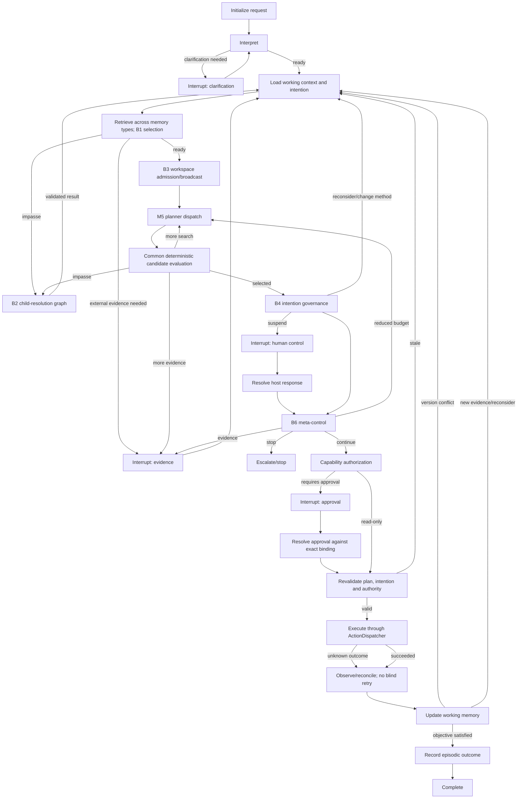

# CoALA cognitive-cycle orchestration with LangGraph4j

## Responsibility boundary

`CognitiveCycleGraph` is the outer execution controller. It is not the CoALA architecture by itself, it does not implement Fan & Lan mechanisms, and it does not implement CoT, ToT or MCTS. It sequences application-owned operations and handles state transitions, conditional routing, interruption and checkpointed resumption.

`CognitiveCycleOperations` is the application integration boundary. A composition-root implementation delegates to the existing framework-neutral modules and authoritative repositories. The graph never calls domain repositories, planner internals, model APIs or external systems directly.

| Layer | M6 integration point | Must remain outside LangGraph4j nodes |
|---|---|---|
| CoALA working memory | `loadContext`, `updateWorkingMemoryFromObservation` | Working-memory service/repository and optimistic version checks |
| CoALA episodic memory | `retrieveEvidence`, `recordOutcomeEpisode` | Episode retrieval, evidence provenance and episode status/promotion policy |
| CoALA semantic memory | `retrieveEvidence` | Semantic fact store and temporal validity; authoritative domain state remains separate |
| CoALA procedural memory | `loadContext`, `proposeCandidates`, `prepareAuthorization` | Runbooks, capability definitions, strategy/procedure versions and policy |
| CoALA internal actions | Retrieval, reasoning/interpretation, working-memory update and episodic learning methods | M3 action dispatch and the memory service implementations |
| CoALA external actions | `observeAndReconcile`, `executeAuthorizedCandidate` | Perception and grounding adapters, `ActionDispatcher`, action ledger and domain invariants |
| Fan & Lan B1/B3 | `retrieveEvidence`, `prepareWorkspace` | B1 activation/utility and B3 admission/broadcast algorithms |
| Fan & Lan B2 | `B2ResolutionSubgraph` | Impasse repository, child-scope policy and parent-return validation |
| Fan & Lan B4/B6 | `governIntention`, `governMetaControl`, `resolveHumanControl` | Intention repository/governor and uncertainty/resource ledger |
| M5 planners | `proposeCandidates`, `evaluateCandidates` | Planner router, CoT/ToT/MCTS search trees/frontiers and deterministic evaluator |
| Runtime | `CognitiveCycleGraph` | LangGraph4j graph/checkpoint/interruption semantics only |

## Main lifecycle

### Routing contracts

- Interpretation returns `READY`, `NEEDS_CLARIFICATION`, or a terminal unsupported/unknown outcome.
- Retrieval returns `READY`, `NEEDS_EXTERNAL_EVIDENCE`, `IMPASSE`, or `FAILED` with a bounded uncertainty value and evidence-set reference.
- Workspace admission returns an admitted immutable snapshot or routes an incomplete/insufficient workspace into B2.
- M5 planning stores planner identity, planner-session reference, candidate-set reference, termination reason and candidate count. Search expansion remains inside M5.
- Candidate evaluation returns one selected candidate, a request for more search/evidence, a typed impasse, or no feasible candidate. No weighted score can override hard constraints because that is enforced by the M5 evaluator before the graph receives a selection.
- B4 governs objective/method authority. B6 controls resource and uncertainty response. Both can return bounded reconsideration or human control, but neither grants a business capability.
- Authorization, approval resolution and pre-execution revalidation precede every state-changing action.
- Successful and uncertain executions pass through observation/reconciliation. An unknown outcome does not route back to `execute`.

## B2 child graph

`B2ResolutionSubgraph` has its own small state: request/execution/scope references, parent working-memory version, impasse case, investigation reference and typed disposition. Its sequence is `open-child -> investigate-child -> validate-parent-return -> END`. It does not receive a broader action authority, cannot mutate the parent objective, and returns only a validated finding reference and disposition. The parent graph then reloads its context and re-evaluates; it does not blindly accept an arbitrary child state mutation.

The child is bounded by a recursion limit and synchronous invocation. The durable B2 case/finding remains the responsibility of the injected B2 service/repository; the parent graph checkpoint is not the B2 repository.

## Checkpoint state

`CognitiveCycleState` stores identifiers and compact routing scalars only: request and execution identity, memory scope/version, evidence/workspace/intention references, planner session/candidate set, selected candidate, impasse case, approval and human-response references, operation/observation references, typed decision status, bounded counters and concise audit events.

It does **not** store full domain snapshots, memory records, evidence payloads, the MCTS/ToT search tree, approval documents, secrets or model transcripts. CoALA memory stores and the M5 planner session store retain their own state. A LangGraph4j checkpoint records orchestration progress, not cognitive memory or authoritative business truth.

## Interruption/resumption protocol

The graph compiles with `interruptBefore` on four host-controlled boundaries:

1. clarification;
2. external evidence;
3. B4/B6 human control;
4. approval.

Before resumption the host must update the same graph thread with an authenticated response reference and, where applicable, actor identity or clarification/evidence payload. The graph refuses to continue if the required reference is missing. The application service resolves that reference against the durable record and verifies its scope. A graph-state update is not itself proof of identity or approval.

Approval resolution is bound to the exact `approvalId`, selected `candidateId`, candidate-set reference, intention ID and intention version. The returned approver identity and evidence reference are retained. Revalidation occurs immediately before execution; a stale plan returns to context loading and planning. A state-changing candidate is structurally forbidden from returning `NO_APPROVAL_REQUIRED`.

Human-control responses are checked against both the host-supplied actor and the exact response reference. This check is defense in depth; the application adapter must authenticate the host actor before writing these graph-state values.

## Execution and reconciliation

`executeAuthorizedCandidate` delegates to M3's capability-scoped `ActionDispatcher` and the action-operation ledger. The graph records the operation and result references. `SUCCEEDED` and `UNKNOWN_OUTCOME` both route to observation. `UNKNOWN_OUTCOME` is not an instruction to retry; the adapter must query/reconcile authoritative external state by operation/idempotency key. If it cannot resolve the result, it returns a nonterminal/failed observation that causes escalation or reconsideration.

After observation the graph asks the working-memory service to persist the observation using its current expected version. A conflict reloads the latest working-memory version and retries the same persisted observation by reference; it does not repeat the external action. Retries are bounded, and an unrecoverable update failure stops the cycle rather than silently declaring completion. Only after an objective-satisfied observation does the graph ask episodic memory to record an outcome episode. The episode is recorded as unverified pending the M2 validation/promotion policy; semantic facts and procedural knowledge are not automatically promoted from the model's conclusions.

## Bounded control

The initial graph bounds clarification to 2 rounds, external evidence requests to 3, planning proposals to 4, and reconsideration/meta-control loops to 5. The LangGraph4j recursion limit is 256 as a final orchestration guard, not a substitute for those domain-specific bounds. These are initial safety defaults and should be tuned using M8 evaluation, deadlines and workload evidence.

## Current integration boundary and remaining work

M6 adds the graph, typed operation contracts, checkpoint-friendly graph state, B2 child graph and graph-level tests. `CognitiveCycleOperations` is an application-owned port. The production composition root that binds every operation to concrete M2/M3/M4/M5 services, plus real-service end-to-end integration tests, remains an explicit M6 acceptance gate and is not delivered in this changeset. The graph tests use deterministic scripted operations to exercise graph control flow without provider credentials or external systems. M7 supplies durable stores/ledgers; M8 exercises the complete application and restart/failure scenarios.
