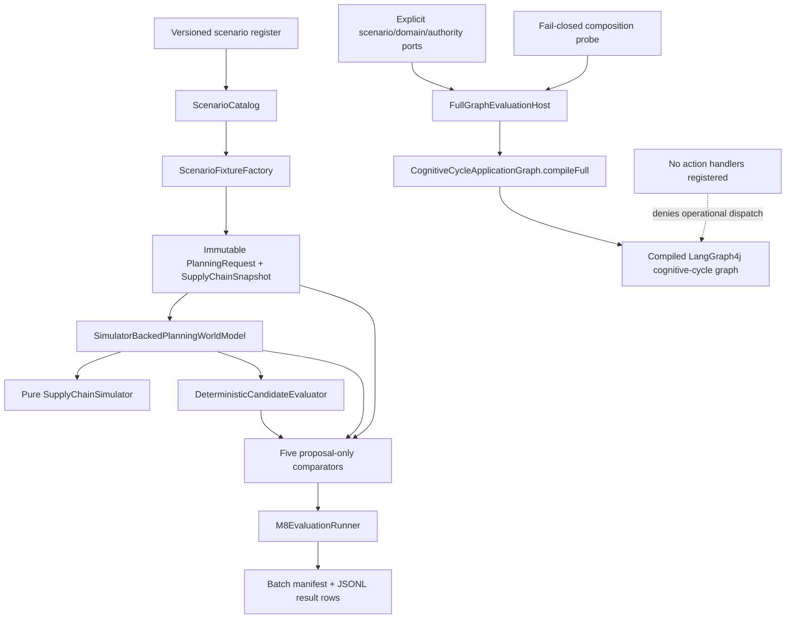

# M8-B1 — evaluation architecture and execution boundaries

**Baseline:** `M8-M7-ACCEPTED-2026-11-19`  
**Corpus:** `M8-B1-v1`  
**Purpose:** establish a reproducible planner-comparison harness and an explicit compile-time composition probe for the complete cognitive-cycle graph.

## 1. Two deliberately separate execution paths

M8-B1 has two paths. They share the accepted application contracts but do not share execution authority.



### Path A — planner-only comparison

`ScenarioCatalog` loads the versioned CSV. `ScenarioFixtureFactory` creates independent immutable `PlanningRequest` and `SupplyChainSnapshot` instances. Every native comparator receives the same request, evidence set, action descriptors, authority policy, hard constraints, simulator and deterministic evaluator.

The comparison implementations are:

| ID | Implementation | M8-B1 configuration |
|---|---|---|
| `COT_SEQUENTIAL` | `SequentialReasoningPlanner` | One-path sequential decisions; deterministic impact ranker; no model provider |
| `TOT_BOUNDED_SEARCH` | `ThoughtSearchPlanner` | Beam width 4; branching factor 4; checkpoint each depth; deterministic ranker |
| `GREEDY_DETERMINISTIC` | `GreedyDeterministicComparator` | Evaluation-only one-step greedy search; highest-scoring feasible successor; action-ID tie break |
| `RAP_INSPIRED_MCTS` | `MctsSearchPlanner` | UCT coefficient 1.41; rollout depth 3; checkpoint each iteration; per-scenario seed |
| `HYBRID_ROUTER` | `PlannerRouter` + `DefaultPlannerSelectionPolicy` | Same native strategy instances, same request and same configured budgets; records the selected planner and explanation |

The deterministic sequential decision provider intentionally removes model-provider nondeterminism from this first comparative baseline. These runs evaluate the planner algorithms and routing policy, not the relative quality of model prompts or LLMs. The MCTS implementation remains RAP-inspired, not a claim of faithful RAP reproduction.

Every proposed transition is applied through `SimulatorBackedPlanningWorldModel` and the pure `SupplyChainSimulator`. Every returned plan is checked by the shared `DeterministicCandidateEvaluator`, which replays the complete action path and checks hard constraints independently of planner scores. A candidate is still only a proposal. The harness has no dispatcher, external connector, approval resolver or action handler.

### Path B — full graph composition probe

`FullGraphEvaluationHost.compileFull(Ports)` calls the actual application composition entry point `CognitiveCycleApplicationGraph.compileFull(...)`. It assembles the existing M2/B1/B2/B3/B4/B6 services, M3 dispatcher contract and M5 planner router. The host uses in-memory test stores and the same repository instances for working-memory writes and retrieval, and episodic writes and retrieval.

`Ports` is explicit and requires all trusted boundaries: decision-domain translation, lifecycle-domain translation, authority, request interpretation, world model, candidate evaluator, all registered `PlannerId` strategies and a clock. This is the intended injection seam for later end-to-end scenario adapters.

`compileFailClosedProbe()` supplies deliberately inert dependencies to prove that the complete graph composition compiles. Those ports throw on invocation. The probe is not a scenario run and must not be described as end-to-end validation. The host internally creates an empty `ActionRegistry`; it registers no external action handler and exposes no handler-registration method.

M8-B4 remains responsible for implementing the deterministic scenario/domain/authority adapters that exercise actual lifecycle transitions, approval decisions, dispatch suppression, restart and reconciliation behavior.

## 2. Corpus and fixture semantics

`m8-scenario-register.csv` is the source of truth for the current corpus:

- 11 request-family rows (`REQ-01` through `REQ-11`)
- 14 failure/adversarial/recovery/concurrency rows (`FAIL-01` through `FAIL-14`)
- 25 independent fixture identities in `M8-B1-v1`
- fixed per-scenario seed and named budget profile
- expected effect boundary (`READ_ONLY`, `PROPOSAL_ONLY` or `APPROVAL_REQUIRED`)

Each fixture has its own IDs, objective, world version, evidence references, memory scope and fingerprint. Fixture fingerprints cover the request fingerprint, canonical initial world, world-model fingerprint, fixture version, scenario ID, seed and named budget profile.

**Important scope distinction:** the presence of a row and an initial-state fixture does not mean its full failure workflow has already been exercised. For example, approval expiry/denial, unknown external command outcome, duplicate outbox delivery, process restart, concurrent observation races and model-provider outage require lifecycle-level adapters and failure injection. M8-B1 registers and fingerprints those cases; M8-B4 must execute and assert their workflows. The `MODEL_UNAVAILABLE` fixture does not call a live model provider.

The initial planner fixture profiles focus on the simulator capabilities and controlled proposal comparison currently available. No B1 result should be used to claim external supplier, carrier, identity or ERP connectivity.

## 3. Reproducibility envelope

Every batch emits one manifest and one JSONL row per scenario/procedure pair. The manifest records:

- accepted M7 baseline ID;
- corpus version and corpus fingerprint;
- world-model and deterministic-evaluator fingerprints;
- planner-configuration fingerprint (algorithm parameters, deterministic ranking policy, greedy tie-break rule and hybrid routing policy version);
- planner IDs, scenario/run counts, budget profiles, fixed seed policy and fixture timestamp;
- explicit planner-only/no-external-effects run mode.

Every row records the fixture and request fingerprints, scenario seed/profile, planner identity, selected hybrid planner, termination reason, candidate/feasibility counts, returned-candidate hard-violation count, expansions, evaluations, model calls, rollouts, pruned branches, backtracks, per-run B6 resource-unit counters, measured runtime and effect boundary.

The scenario's simulated timestamp remains fixed. Planner clocks are moving clocks offset onto that fixed fixture timeline. This preserves the fixture's temporal context across execution dates while allowing `PlannerBudget.deadline` and `maxRuntime` to advance and stop a run. The greedy comparator checks the same deadline/runtime contract and the same expansion/evaluation ceilings.

Runtime nanoseconds are intentionally measured observations, not deterministic fixture values. Search decisions are reproducible where the algorithm/seed are deterministic; wall-clock timing is not claimed to be bit-for-bit repeatable.

## 4. What B1 does not claim

- It does not claim 25 successful end-to-end workflows. B1 runs 25 planner input fixtures against five proposal procedures; lifecycle failures are reserved for B4.
- It does not compare model-generated chain-of-thought or prompt quality; the sequential baseline is supplied by a deterministic structured decision provider.
- It does not establish that B1/B3 policy learning occurred. Retrieval/admission/broadcast observations alone are not outcome-attributed learning evidence.
- `RecordingPlannerResourceMeter` records per-run planner counters. It is not the authoritative shared/durable B6 budget ledger and does not establish restart/concurrency ownership.
- It does not test approval, external dispatch, exactly-once effects, PostgreSQL restart, or live integrations. It intentionally cannot dispatch external actions.
- It does not alter the production `PlannerRouter`, add the greedy comparator to production routing, or reopen M7 infrastructure.

## 5. Running the baseline harness

From the repository root, run:

```bash
./scripts/run-m8-evaluation.sh > m8-evaluation-results.jsonl
```

The script first executes the complete Java 21 reactor test/install (`clean install`), then invokes the evaluation CLI from the evaluation module with its runtime dependency classpath. Maven build output is sent to standard error; the JSONL batch manifest and result rows are written to standard output. Add `--list` to print only the registered scenario identities:

```bash
./scripts/run-m8-evaluation.sh --list
```

The generated JSONL includes elapsed wall-clock nanoseconds. Do not compare timing as if it were a deterministic fixture value. Archive the exact output together with the baseline ID, code revision and SHA-256 of the results when running M8-B2.

## 6. Tests and acceptance gate

The evaluation module adds focused tests for:

1. loading all 25 register rows and verifying the 11/14 split;
2. stable fixture/request fingerprints over repeated fixture generation;
3. distinct IDs and fixture identities across scenarios;
4. proposal-only greedy planning through the common simulator evaluator;
5. read-only scenarios yielding no action candidates;
6. expired greedy deadlines yielding zero expansions;
7. advancing fixture clocks staying on the fixed corpus timeline while leaving the configured deadline in the future;
8. the full graph compiling through `CognitiveCycleApplicationGraph.compileFull(...)` with fail-closed ports;
9. one manifest plus exactly `25 × 5 = 125` planner-only result rows and the planner configuration fingerprint.

The final M8-B1 acceptance gate is the Java 21 Maven reactor `clean verify` in GitHub Actions. Local source construction and archive checks do not replace that CI result.
